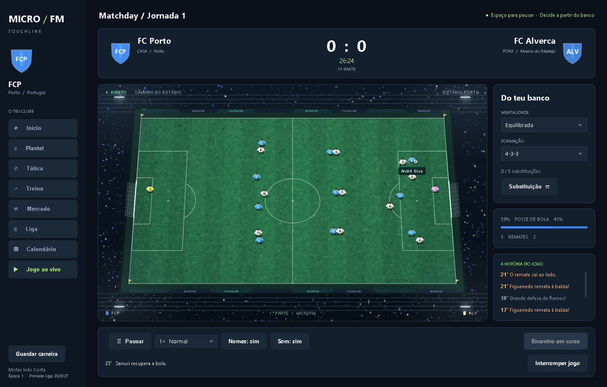
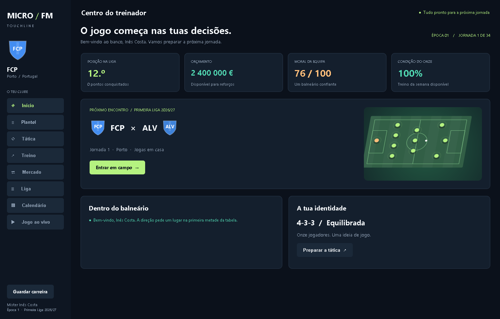

# MicroFM / Touchline

Um jogo de gestão de futebol de secretária, em português, construído com **Java, AWT, Swing e Java2D**, sem dependências externas. Esta edição foi preparada para alunos do **2.º ano com conhecimentos de POO**.

**Para jogar no Windows:** abre `Jogar.cmd`. O `MicroFM.jar` já está compilado e precisa de Java 17 ou superior; Java 25 também funciona. Em qualquer sistema com ambiente gráfico:

```sh
java -jar MicroFM.jar
```

O jogo arranca em ecrã inteiro. Usa **Esc** para voltar à janela ou **F11** para alternar entre os dois modos.

Na entrada, a **Primeira Liga 2026/27** já vem selecionada. Escolhe o clube e o nome do treinador ou carrega em **Ver demonstração** para assistir a um FC Porto – FC Alverca com jogadores dos dois plantéis. O encontro é representado num estádio com 22 jogadores, bola com trajetória e rasto, iluminação, sombras, público, redes e celebrações com partículas. Os controlos permitem pausar, acelerar até 8×, alterar táticas e fazer cinco substituições. O som das bancadas está ligado por defeito. Usa **Som** para silenciar também os apitos e os festejos.

O árbitro assinala faltas e foras de jogo, e o motor executa livres, penáltis, lançamentos laterais, cantos e pontapés de baliza. O relógio mostra a compensação quando uma jogada perigosa prolonga o período. As bancadas reagem aos lances e os apitos distinguem as decisões do árbitro, o intervalo e o fim do jogo.

Usa **Interromper jogo** para descartar o encontro e voltar à gestão do clube. A mesma jornada fica disponível para jogar de novo. Na demonstração, o botão leva-te de volta ao ecrã inicial.



**Primeira Liga 2026/27** inclui 18 clubes, 34 jornadas e plantéis com 577 jogadores das fichas da 11.ª jornada, incluindo os adversários dos jogos ao vivo. A primeira época segue os emparelhamentos do calendário oficial. O jogo simula resultados, notas de qualidade, orçamentos, mercado e épocas seguintes. Os dados estão incluídos no JAR para jogar offline. [Calendário oficial](https://www.ligaportugal.pt/news/28156/os-calendarios-dos-campeonatos-profissionais-202627) · [Fichas dos plantéis](https://www.ligaportugal.pt/news/29039/media-kits-jornada-11-da-liga-portugal-betclic)

**Liga MicroFM** tem oito clubes fictícios e 14 jornadas. As duas ligas incluem escolha do onze, três formações, três mentalidades, treino semanal, mercado, condição física, lesões, moral, classificação e gravação automática no fim de cada jornada.



## Código e aulas

Os objetos substituem os arrays indexados da versão introdutória. O domínio protege as regras; o motor simula o encontro; a vista desenha o estado. Um temporizador Swing solicita atualizações a cada 16 ms e mede o tempo decorrido, com o cenário do estádio guardado em memória para reduzir o trabalho de cada desenho. A cadência efetiva depende da máquina e da resolução.

- [Guia do treinador](GUIA.txt): jogar, guardar e recompilar.
- [Arquitetura](docs/ARQUITETURA.md): classes, responsabilidades e animação.
- [Ligação às aulas](docs/AULAS.md): referências exatas aos PDFs, requisitos e propostas de exploração.
- `legado/MicroFM.java`: versão anterior de consola, preservada para comparação; requer Java 25.

Os documentos fornecidos foram tratados como referência curricular. Swing e Java2D são uma extensão prática; não se atribuem estas APIs aos slides de Engenharia de Software.

## Compilar e verificar

Com JDK 17 ou superior, abre `Compilar.cmd` e depois `Testar.cmd`. Os scripts não precisam de Maven, Gradle, Python nem de acesso à Internet. Comandos equivalentes:

```sh
javac -encoding UTF-8 --release 17 -d build/classes MicroFM.java src/microfm/model/*.java src/microfm/match/*.java src/microfm/ui/*.java
jar --create --file MicroFM.jar --main-class MicroFM -C build/classes MicroFM.class -C build/classes microfm -C src microfm/data
```

O teste de carreira cobre calendário, onze, transferências, treino, classificação, suplentes, épocas e persistência inválida. O teste do motor percorre encontros completos e verifica continuidade, determinismo e substituições. O teste Swing percorre botões reais no EDT e renderiza os nove ecrãs sem precisar de monitor.

Também existe `python tests/testar.py`, que compila e testa numa pasta temporária. Para medir o desenho localmente: `Testar.cmd --benchmark`. Para gerar as nove imagens da aplicação:

```sh
java -Djava.awt.headless=true -jar MicroFM.jar --render build/previews
```

Na entrada, escolhe a liga da gravação antes de clicar em **Continuar carreira**. Para transportar uma carreira, copia o ficheiro `carreira-swing.microfm` para a Liga MicroFM ou `carreira-primeira-liga-2026-27.microfm` para a Primeira Liga. As gravações antigas da edição gráfica abrem na Liga MicroFM. Extrai o ZIP antes de abrir o jogo.
