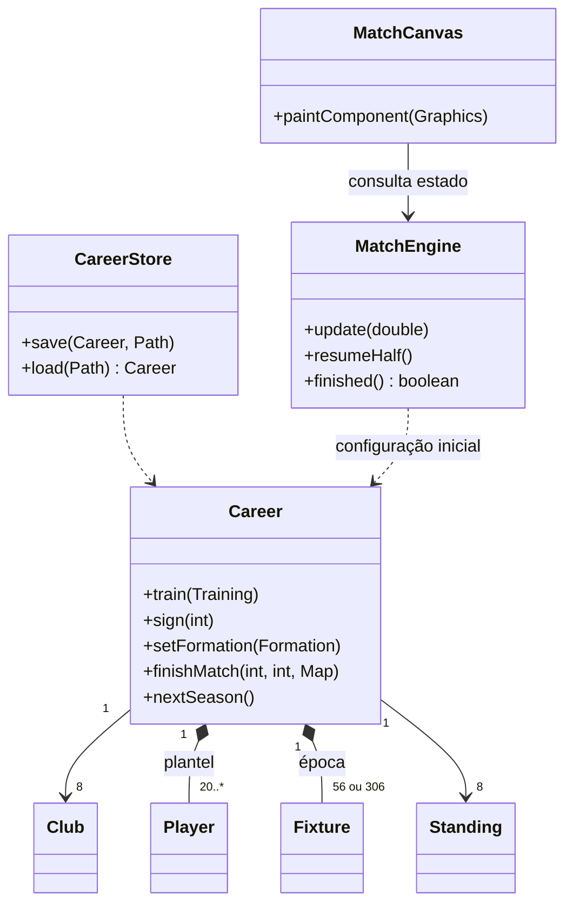

# Arquitetura do MicroFM gráfico

O MicroFM é uma aplicação Java de secretária com AWT, Swing e Java2D. A interface de gestão e a transmissão do encontro partilham objetos de domínio, mas têm responsabilidades diferentes. O motor do encontro produz estado; o campo desenha esse estado; a carreira aplica o resultado quando o encontro termina.

## Responsabilidades

| Localização | Responsabilidade |
| --- | --- |
| `src/microfm/model` | Clubes, jogadores, formação, mentalidade, calendário, classificação, orçamento, treino e mercado. |
| `Career` | Coordenar as regras da carreira e proteger invariantes nas operações públicas. |
| `League` | Identificar a competição, os clubes e os limites de cada época. |
| `PrimeiraLiga` | Ler os plantéis e o calendário de 2026/27 incluídos no JAR. |
| `CareerStore` | Ler e escrever um formato explícito de texto, validar os dados e guardar por substituição atómica quando suportada. |
| `src/microfm/match` | Simulação temporal do encontro, eventos e desenho do estádio. |
| `MatchEngine` | Avançar o encontro, resolver passes e remates, contabilizar o resultado e gerir o intervalo. |
| `MatchCanvas` | Desenhar relvado, jogadores, bola, sombras, público e efeitos visuais com Java2D. |
| `src/microfm/ui` | Janelas, navegação, tabelas, decisões do treinador e controlo da reprodução. |

O modelo não conhece botões nem janelas. A pintura não escreve ficheiros nem atualiza a classificação. As listas expostas pela carreira permitem consultar o estado sem substituir diretamente as coleções internas. Alterações passam por operações como `train`, `sign`, `setFormation` e `finishMatch`.



O diagrama resume as relações relevantes para a leitura; não pretende listar todos os atributos e classes auxiliares.

## Tempo, animação e Swing

A criação e alteração dos componentes Swing ocorre no Event Dispatch Thread, através de `SwingUtilities.invokeLater`. Um `javax.swing.Timer` solicita atualizações com intervalo de cerca de 16 ms. O controlador mede o tempo efetivamente decorrido, aplica a velocidade escolhida e passa esse intervalo ao motor.

O motor e os efeitos visuais usam tempo decorrido em vez de contar desenhos. `paintComponent` apenas representa o estado atual e pode ser chamado pelo Swing quando a janela é exposta ou redimensionada. Não se usa uma espera ativa para regular a velocidade. A pausa suspende o avanço do encontro e o intervalo aguarda uma decisão explícita do treinador.

A separação entre estado e pintura permite executar testes do domínio sem monitor e desenhar o campo para uma `BufferedImage`. Fundos que não dependem de cada lance podem ser reutilizados em vez de reconstruídos em todos os quadros. Antialiasing, transparência, gradientes e sombras pertencem à vista; o resultado desportivo pertence ao motor.

## Persistência

`CareerStore` usa um formato de texto versionado e valida os valores lidos. A versão 2 regista a liga e a versão 1 é lida como Liga MicroFM. A gravação usa um ficheiro temporário e a substituição do destino, reduzindo o risco de deixar uma gravação parcial.

A interface só substitui a carreira atual depois de `load` devolver um objeto válido. As regras são verificadas também fora da interface: desativar um botão é útil para explicar a disponibilidade de uma ação, mas não substitui a validação de domínio.

## Decisões e limites

- Usar apenas a biblioteca padrão facilita abrir o projeto nas aulas e distribuir o jogo sem um gestor de dependências.
- Enums representam alternativas fechadas, como posições, formações e mentalidades. Evitam números de significado implícito espalhados pelo código.
- A composição separa carreira, encontro e vista. Não é necessário criar uma hierarquia de classes para cada variação do jogo.
- O calendário e a classificação são verificáveis independentemente da apresentação. A geração com semente facilita repetir cenários de teste.
- A simulação é uma interpretação simplificada de futebol. A apresentação representa acontecimentos e decisões do jogo, sem pretender modelar toda a física ou arbitragem real.

Para começar a leitura, seguir `Career.create`, uma ação como `Career.train`, `MatchEngine.update` e finalmente `MatchCanvas.paintComponent`. A documentação [AULAS.md](AULAS.md) relaciona estas decisões com páginas específicas dos materiais fornecidos.

## Teste opcional com janela real

`tests/TestNativeSwing.java` complementa os testes sem monitor. Abre duas janelas sucessivas, verifica o temporizador real, fecha um encontro terminado antes da confirmação da jornada e confirma que o resultado foi guardado. Depois recupera a carreira, treina e verifica que guardar de forma assíncrona mantém as sessões já gastas indisponíveis. O teste só aceita uma pasta nova dentro de `build/native-smoke` e recusa qualquer pasta que já contenha uma carreira.

Para o executar explicitamente no Windows, a partir da raiz do projeto:

```powershell
New-Item -ItemType Directory -Force build/native-smoke/classes | Out-Null
$nativeSources = (Get-ChildItem src -Filter '*.java' -Recurse).FullName
javac -encoding UTF-8 --release 17 -d build/native-smoke/classes $nativeSources tests/TestNativeSwing.java
$nativeFolder = Join-Path (Resolve-Path build/native-smoke).Path ('run-' + [guid]::NewGuid().ToString('N'))
New-Item -ItemType Directory -Path $nativeFolder | Out-Null
Push-Location -LiteralPath $nativeFolder
try { java -cp ../classes microfm.ui.TestNativeSwing --native } finally { Pop-Location }
```

Este teste não faz parte da execução normal de `tests/testar.py`. Os ficheiros e capturas ficam na pasta isolada criada para a execução.
